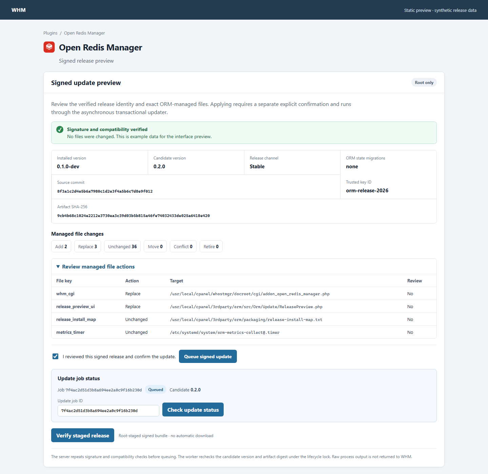

# WHM signed update preview

The WHM page exposes a root-only **Verify staged release** action. It checks a manually staged signed release and displays its installed and candidate versions, signature key ID, artifact digest, and managed-file actions. A conflict-free preview also exposes an explicit confirmation form that queues the signed update asynchronously; the browser request never runs the apply transaction itself.

## Fixed paths

Build the signed bundle with the [offline release signing guide](release-signing.md); keep the private key outside the repository and target server.

The preview uses only these root-owned paths:

| Purpose | Path |
|---|---|
| Release metadata | `/var/cpanel/orm/updates/staged/release.metadata` |
| Detached signature | `/var/cpanel/orm/updates/staged/release.sig` |
| Release archive | `/var/cpanel/orm/updates/staged/release.tar.gz` |
| Pinned public keys | `/etc/orm/release-keys/` |
| Installed file manifest | `/usr/local/cpanel/3rdparty/orm/install-manifest` |

Create the staging and key directories with mode `0700`, owned by root. Store a public key as `<key_id>.pem` where `<key_id>` matches the signed metadata. Never put a private signing key on the cPanel server or in this repository. The verifier rejects unsafe ownership, permissions, symlinks, malformed metadata, expired or incompatible releases, invalid signatures, and archives that do not match the signed install map.

The root operator stages the bundle files using the fixed names above, then submits the preview form through the authenticated `/cpsess` WHM session. Preview uses `/usr/bin/bash` with a fixed argument list under a 30-second timeout; stderr is discarded and untrusted file paths cannot be supplied by the browser. Applying requires a fresh server-side preview plus an explicit checkbox confirmation. ORM stores a random job ID and the candidate version and SHA-256 digest in root-owned mode-0600 state under `/var/cpanel/orm/updates/jobs/`, then launches the installed worker using fixed `/usr/bin/systemd-run` and `/usr/bin/perl` arguments. The worker rechecks that identity inside the apply transaction's lifecycle lock before changing files. Raw process output is not returned to WHM.

The **Check update status** form reads the sanitized job record. Terminal states include succeeded, failed, recovery required, and interrupted. If an unfinished job's transient systemd service is no longer active, ORM marks it interrupted or recovery required when a transaction journal remains. Review the [recovery guide](update-recovery.md) before retrying an interrupted or incomplete transaction. ORM does not automatically retry an apply job.

## Current boundaries

- No remote update feed or automatic downloader is configured; staging remains a root-operated task.
- The worker uses transient systemd services, so `systemd-run` must be available. The apply transaction has no hard wall-clock timeout that could kill it while files are changing.
- Builds that have only the earlier preview-only WHM page cannot launch this worker. Bootstrap those installations with the reviewed root-only CLI update path once; subsequent releases can use the asynchronous WHM workflow.
- Live disposable-host validation of queue races, service startup, rollback, reboot recovery, and package transitions is still required before production use.
- The preview is supported only for an installed schema v3 manifest. Adopt older manifests only through the exact-current-package adoption procedure in the [update lifecycle guide](update-lifecycle.md).
- This preview does not establish compatibility with every cPanel/WHM release or replace a complete install, rollback, recovery, and post-update validation gate.
